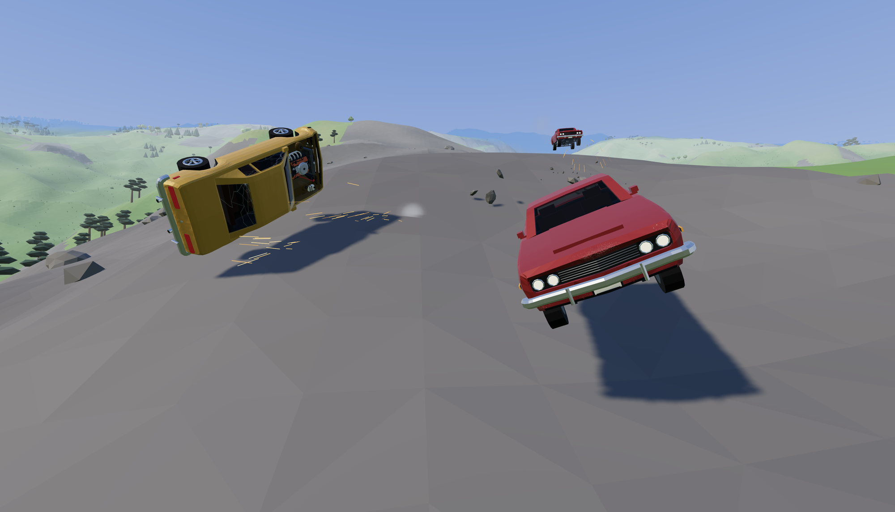

# Bouncy Car

A big, floaty 70s coupe, an endless mountain to drive down, and nothing to do but catch air, land
hard and lose a bumper or two. It runs in the browser.

**[Play it in your browser](https://kjeksfjes.github.io/bouncy-car/)** (keyboard needed, so a
desktop or laptop).



The fun is in the feel: soft, bouncy suspension with lots of body roll, big jumps and satisfying
crunches. There's no goal and no way to fail. You drive, you crash, you press N for a new car.

## What's in it

- **An endless mountain.** It's generated from a seed as you drive down it: valleys, ridges,
  gullies, rocky knolls, moguls and kicker ridges, with now and then a steep drop or a ski-jump
  hump. The snow gives way to a thaw and then to green grassland, through forests and open
  meadows.
- **A car that falls apart.** Crumple zones front and rear and a roof that caves in. Doors, hood
  and bumpers swing on hinges before they tear off, glass cracks and shatters, lights dangle on
  their wires, hubcaps roll away, wheels come off, and coolant and oil drip from the wreck.
- **A world that reacts.** Boulders break loose and tumble when hit hard enough, cairns topple,
  tyres tear the turf, and rooks burst out of the trees you hit.
- **Sound made in code.** Every sound is synthesised live with the Web Audio API, no recordings:
  a burbling V8, tyres on snow, grass and rock, scraping metal, breaking glass, tumbling stones
  and cawing rooks.
- **Traffic and an autopilot.** Other cars come and go around you, and P lets the same AI drive
  yours. It plans its way down the mountain, threads through forests and goes for the cairns.
- **Slow motion and a photo mode** for watching it all come apart.

## Controls

| Key | |
|---|---|
| W / S or ↑ / ↓ | Throttle, brake and reverse |
| A / D or ← / → | Steer (in the air: roll) |
| S in the air | Level the car toward its flight path |
| Space | Handbrake: tap to park, hold to lock the rear and slide |
| L | Headlights |
| R | Reset upright (keeps the damage) |
| N | New car |
| B / Shift+B | Bring the next biome ahead / jump straight to it |
| C | Next camera: chase or cinematic helicopter |
| T | Slow motion (' slower, Shift+' faster) |
| P | Autopilot |
| M | Mute |
| H | Hide the controls card |
| Esc | Pause; right-drag or Shift+drag from there for photo mode |

Drag the mouse to swing the camera round the car and scroll to zoom.

## Running it

You'll need [Node.js](https://nodejs.org/) 20.19 or 22.12 or newer.

```sh
npm install
npm run dev
```

Then open http://localhost:5291. Add `?seed=1234` to the address
for a different mountain.

Other scripts:

- `npm run build`: type-check and build a static site into `dist/`.
- `npm run typecheck`: type-check only.
- `npm run test:e2e`: a Playwright smoke test that starts the game and lets the autopilot drive.

## How it's made

TypeScript, [Three.js](https://threejs.org/) for rendering, [Rapier](https://rapier.rs/) for
physics, the Web Audio API for sound and [Vite](https://vite.dev/) to build. The car's suspension
and tyres are custom raycast physics, and the terrain is pure functions of position, so any spot
on the mountain can be asked about without building it first.

There are no 3D models or sound files. The car is lofted in code from profile curves traced from
orthographic drawings, the trees, rocks and birds are built in code too, and every sound is synthesised.

[`BRIEF.md`](BRIEF.md) describes the game in detail, and [`CHANGELOG.md`](CHANGELOG.md) lists what
each release brought.

## Credits

The rhythm and resonance of the rook calls were measured from a recording by Jorge Leitão on
[xeno-canto](https://xeno-canto.org/845012) (XC845012). The recording isn't used in the game; the
calls are synthesised.
